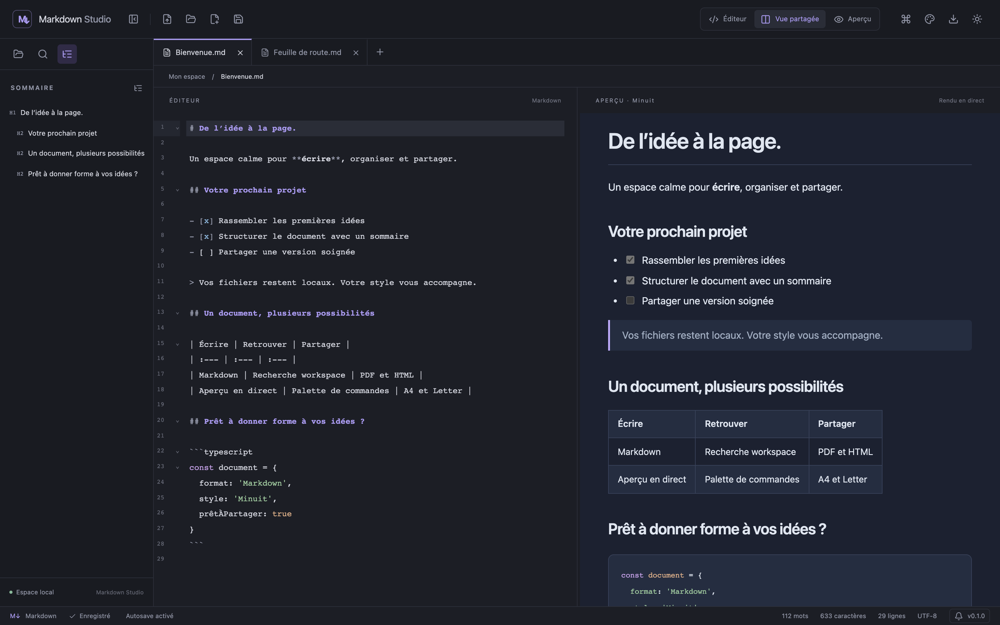

<div align="center">

# Markdown Studio

### Écrivez en Markdown. Publiez avec votre style.

Un éditeur desktop pour vos notes, votre documentation et vos projets.<br />
Fichiers locaux, aperçu en direct et exports soignés — sans compte à créer.

[](https://github.com/pierrelmy/mardown-studio/releases/latest)
[](https://github.com/pierrelmy/mardown-studio/actions/workflows/ci.yml)
[](https://github.com/pierrelmy/mardown-studio/actions/workflows/release.yml)
[](https://github.com/pierrelmy/mardown-studio/actions/workflows/ci.yml)

**[Télécharger l’application](https://github.com/pierrelmy/mardown-studio/releases/latest)** ·
[Notes de version](https://github.com/pierrelmy/mardown-studio/releases) ·
[Signaler un problème](https://github.com/pierrelmy/mardown-studio/issues)

</div>



## Un espace de travail pour vos documents

Markdown Studio réunit un éditeur Markdown, un explorateur de dossiers et un aperçu
qui se met à jour pendant la saisie. Vos documents restent des fichiers `.md`
classiques, lisibles avec vos autres outils.

| Écrire                                          | Organiser                            | Partager                            |
| ----------------------------------------------- | ------------------------------------ | ----------------------------------- |
| Éditeur CodeMirror avec coloration et recherche | Dossiers locaux et onglets multiples | Export PDF et HTML                  |
| Aperçu Markdown, KaTeX et Mermaid               | Création, renommage et corbeille     | Quatre thèmes de document           |
| Modes éditeur, aperçu et vue partagée           | Autosave et signalement des conflits | Typographie et formats A4 ou Letter |

## Installer depuis GitHub

Ouvrez la **[dernière release](https://github.com/pierrelmy/mardown-studio/releases/latest)**,
puis sa section **Assets** et choisissez le fichier correspondant à votre système.
Aucune installation de Node.js ou de npm n’est nécessaire pour utiliser l’application.

| Système                 | Fichier à télécharger                             | Architecture           |
| ----------------------- | ------------------------------------------------- | ---------------------- |
| macOS                   | `Markdown.Studio-<version>-mac-universal.dmg`     | Apple Silicon et Intel |
| Windows                 | `Markdown.Studio-<version>-win-x64.exe`           | x64                    |
| Linux — AppImage        | `Markdown.Studio-<version>-linux-x86_64.AppImage` | x64                    |
| Linux — Debian / Ubuntu | `Markdown.Studio-<version>-linux-amd64.deb`       | x64                    |

`<version>` désigne le numéro de la release. Les archives **Source code** servent au
développement ; les fichiers `.yml` et `.blockmap` sont utilisés par le système de mise à jour.

### macOS

1. Téléchargez et ouvrez le fichier `.dmg`.
2. Glissez **Markdown Studio.app** dans **Applications**.
3. Éjectez le volume du DMG, puis lancez l’application depuis **Applications**.
4. Pour la garder dans le Dock : clic droit sur son icône → **Options → Garder dans le Dock**.

Les builds actuels utilisent une signature ad hoc et ne sont pas notarisés par Apple.
Si macOS bloque la première ouverture, suivez les [instructions officielles Apple](https://support.apple.com/fr-ca/102445)
pour ouvrir une application provenant d’un développeur non identifié.

### Windows

1. Téléchargez l’installateur `.exe` depuis les assets de la release.
2. Lancez-le et suivez les instructions d’installation.
3. Ouvrez **Markdown Studio** depuis le menu Démarrer.

### Linux

**AppImage** — placez le fichier dans un dossier où vous souhaitez le conserver,
puis rendez-le exécutable et lancez-le. Exemple pour la release `0.2.0` :

```sh
chmod +x Markdown.Studio-0.2.0-linux-x86_64.AppImage
./Markdown.Studio-0.2.0-linux-x86_64.AppImage
```

Adaptez le numéro de version au fichier téléchargé. Les mises à jour intégrées sont
prises en charge pour le format AppImage.

**Debian / Ubuntu** — installez le paquet téléchargé avec APT. Exemple pour `0.2.0` :

```sh
sudo apt install ./Markdown.Studio-0.2.0-linux-amd64.deb
```

Pour une installation `.deb`, téléchargez et installez le nouveau paquet lors d’une
mise à jour.

## Vos premières minutes

1. **Ouvrez un dossier** pour retrouver vos documents dans l’explorateur, ou créez un nouveau document.
2. **Écrivez** dans l’éditeur et choisissez votre mode d’affichage : éditeur, aperçu ou vue partagée.
3. **Enregistrez une première fois** votre brouillon pour lui donner un emplacement et activer l’autosave.
4. **Personnalisez** le rendu avec l’icône palette → **Style du document**.
5. **Exportez** en PDF ou HTML depuis la barre supérieure.

Les onglets indiquent les modifications non enregistrées. Si un fichier est modifié
par une autre application, un onglet propre est rechargé ; un onglet modifié signale
un conflit et permet de recharger le fichier ou d’enregistrer une copie.

## Une identité visuelle pour chaque document

Le thème du document est indépendant du thème clair ou sombre de l’interface.
L’aperçu, les exports, la coloration du code et les diagrammes partagent la même palette.

| Thème         | Style                                                            |
| ------------- | ---------------------------------------------------------------- |
| **Studio**    | Fond clair et typographie sobre pour les notes du quotidien      |
| **Éditorial** | Papier ivoire et caractères à empattements pour les textes longs |
| **Technique** | Accents bleus et titres monospace pour la documentation          |
| **Minuit**    | Fond encre et accents lavande pour une lecture en sombre         |

Réglez la taille du texte, l’interligne et la largeur de lecture, puis choisissez le
format PDF **A4** ou **Letter**. Les préférences s’appliquent à tous les documents et
sont conservées entre les sessions. Elles ne modifient pas le contenu des fichiers Markdown.

## Mises à jour intégrées

L’application installée recherche une version stable plus récente au démarrage.
Le bouton de version dans la barre d’état ouvre **Versions et mises à jour** et affiche
les changements de toutes les versions intermédiaires.

1. Cliquez sur **Télécharger la mise à jour**.
2. Une fois le paquet prêt, cliquez sur **Installer et relancer**.
3. Choisissez quoi faire des documents non enregistrés avant le redémarrage.

Sur macOS, l’installateur dédié vérifie le paquet et conserve l’ancienne application
jusqu’à la confirmation du démarrage de la nouvelle. Si ce démarrage échoue, il restaure
l’ancienne version. L’application doit être installée dans un dossier accessible en
écriture ; elle ne peut pas être mise à jour depuis un DMG monté.

Les installations antérieures à ce système doivent être remplacées une première fois
par une release récente. Les vérifications réseau et les installations sont désactivées
en mode développement.

## Fichiers locaux et confidentialité

- Les documents sont enregistrés sur votre disque ; aucun service de synchronisation n’est requis.
- La session conserve des chemins et des préférences, sans copie du texte de vos documents.
- GitHub est contacté pour les mises à jour. Les images distantes et les liens externes peuvent aussi utiliser le réseau.
- L’aperçu assainit le HTML généré et affiche le HTML brut des documents comme du texte.

<details>
<summary>Formats pris en charge et limites actuelles</summary>

- Markdown standard, tableaux, tâches et blocs de code colorés.
- Formules KaTeX avec `$…$` et `$$…$$` ; diagrammes dans des blocs `mermaid`.
- Images raster locales relatives au document dans un workspace, images HTTPS et data URL raster.
- Fichiers de 20 Mo maximum ; 20 000 entrées et 24 niveaux de profondeur par workspace.
- Fichiers cachés, liens symboliques et `node_modules` exclus de l’explorateur ; SVG locaux non chargés.
- Les images locales autorisées et les polices KaTeX sont intégrées aux exports HTML ; les images HTTPS restent distantes.
- La recherche globale, les liens entre documents, la palette de commandes et le Live Preview intégré restent des évolutions.

</details>

## Développer et contribuer

La stack repose sur **Electron, React, TypeScript, electron-vite, Tailwind CSS et
CodeMirror 6**, avec Marked, KaTeX et Mermaid pour le rendu.

Prérequis : Node.js **22.12 minimum** et npm ; la CI utilise Node.js **24**.

```sh
git clone https://github.com/pierrelmy/mardown-studio.git
cd mardown-studio
npm ci
npm run dev
```

La commande de développement installe le binaire Electron s’il manque, puis ouvre
l’application. Le premier téléchargement nécessite un accès réseau ou un cache disponible.

```sh
npm run check          # format, TypeScript strict et tests unitaires
npm run test:coverage  # couverture et seuils bloquants
npm run test:desktop   # tests dans une vraie fenêtre Electron
npm run dist -- --mac  # créer un DMG et un ZIP localement
```

Consultez le **[guide de contribution](CONTRIBUTING.md)** pour les scripts complets,
l’architecture, les tests, le packaging et le fonctionnement des releases.
Pour proposer une évolution ou signaler un bug, ouvrez une [issue](https://github.com/pierrelmy/mardown-studio/issues).

## Qualité et publication

La [CI](https://github.com/pierrelmy/mardown-studio/actions/workflows/ci.yml) vérifie les
tests, la couverture, la compilation et le packaging sur **macOS, Windows et Linux**
à chaque push et PR. Le badge de couverture ouvre les rapports des exécutions : les
pourcentages sont consultables dans leurs résumés et les rapports HTML téléchargeables.

Après une CI réussie sur `main`, le workflow [Release](https://github.com/pierrelmy/mardown-studio/actions/workflows/release.yml)
calcule une version à partir des Conventional Commits et publie les installateurs avec
leur changelog. La publication attend la réussite des builds de toutes les plateformes.

---

## Licence

Copyright © 2026 **Pierre Lamey**. Le projet est distribué sous la
[licence Markdown Studio — redistribution gratuite](LICENSE), une licence personnalisée
à **source disponible**, avec interdiction de revente.

L’utilisation personnelle ou professionnelle, la modification et le partage gratuit
sont autorisés avec conservation des mentions et de la licence. La vente du logiciel,
de ses versions dérivées ou de leur accès payant nécessite une autorisation écrite.
La licence ne restreint pas la commercialisation de vos propres documents et exports.

La restriction de revente signifie que cette licence n’est pas « open source » au sens
de l’[Open Source Initiative](https://opensource.org/osd). Les dépendances tierces
conservent leurs propres licences. Le texte complet dans [LICENSE](LICENSE) fait foi.
